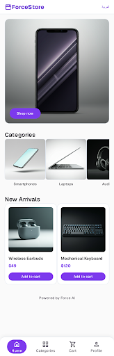
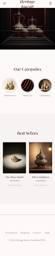
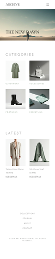
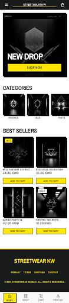

# Ebda Design — sizing rules (ahmad standing preference)

Ahmad's standing rule, codified 2026-05-16 after multiple rounds of
"things are still too big": **default to compact ecommerce sizing on
both desktop and mobile.** No oversized cards, hero-tier imagery, or
marketing-page chrome inside transactional surfaces.

When in doubt, lean SMALLER. Reference for sane defaults is the
compact Egyptian storefronts.

## Industry benchmark sizes (apply these)

| Element                        | Mobile (W)                                                                   | Desktop (W)  | Notes                                                                                                                                                                                                                                                                             |
| ------------------------------ | ---------------------------------------------------------------------------- | ------------ | --------------------------------------------------------------------------------------------------------------------------------------------------------------------------------------------------------------------------------------------------------------------------------- |
| Product card                   | 150-180px                                                                    | 180-220px    | Cap with `max-w-[200px] md:max-w-[200px]`. Theme ProductCards inherit same cap so PDP "related products" matches main grid sizing                                                                                                                                                 |
| Category card                  | 170-200px                                                                    | 240-280px    | Cap with `max-w-[200px] md:max-w-[280px]`. Mobile bumped DOWN per Ahmad 2026-05-16 'on mobile make categories a little bit smaller' while desktop stays at the hero-section size. Grid gap stays at gap-3 md:gap-4                                                                |
| Carousel item (homepage strip) | 140-180px                                                                    | 180-220px    | `w-[44vw] sm:w-[28vw] md:w-[22vw]` baseline                                                                                                                                                                                                                                       |
| Logo header                    | 96px (h-24)                                                                  | 112px (h-28) | Mobile capped by `max-w-[65%]` on the centered Link + Account icon hidden on mobile (md:inline-flex) so the freed row width gives the bigger logo room. Row height bumped to h-28 mobile / md:h-32 to accommodate. Ahmad 2026-05-16 'want it more bigger both mobile and desktop' |
| Hero image                     | `aspect-[1920/700]` mobile + desktop (always landscape per Ahmad 2026-05-18) | —            | Source 1920×700 landscape on both breakpoints. Optional mobile-specific crop = 1080×394 (same aspect, smaller file for mobile bandwidth). Portrait mobile crops NO LONGER supported — would letterbox. `HeroBanner.tsx` enforces.                                                 |
| Internal card padding          | p-3 mobile / p-4 desktop                                                     | —            | Never p-5+ on cards                                                                                                                                                                                                                                                               |
| Card content gap               | gap-2                                                                        | —            | Never gap-3+ between name/price/cta                                                                                                                                                                                                                                               |

## Typography sizes (apply these across all 5 themes)

Standing rule updated 2026-05-16 (second pass) per Ahmad's Wady Aljuz baseline:
**every text zone defaults to 16px (text-base) at the theme level.** Headings,
body, kickers, subtitles, seeAll links, CTAs — all 16px platform defaults.
Theme identity carries via font-weight + tracking + font-family ONLY
(modern=semibold-sans, elegant=hairline-tracking-wide, bold=font-black-
uppercase, classic=serif-normal, minimal=light-tracking-wide), NEVER via
size differentiation. Hero headline remains the only intentional scale
exception (36-72px responsive) because hero is the brand statement.

Merchants can override any zone via Typography admin (per-store).
Earlier responsive heading scales (text-3xl → text-5xl, etc.) were
reverted to text-base on 2026-05-16 after Ahmad's "make those the main
sizes of everything" directive — flat hierarchy by default; merchant
opts up via admin if their brand needs heading prominence.

| Element (pack-styles token)                        | Mobile  | sm (640+)  | md (768+) | lg (1024+) | Tailwind                                                                                                             | Notes                                                                                                                                                                                                                                                                                                 |
| -------------------------------------------------- | ------- | ---------- | --------- | ---------- | -------------------------------------------------------------------------------------------------------------------- | ----------------------------------------------------------------------------------------------------------------------------------------------------------------------------------------------------------------------------------------------------------------------------------------------------- |
| **Section title** (`sectionHeading`)               | 30px    | 36px       | —         | 48px       | `text-3xl sm:text-4xl lg:text-5xl`                                                                                   | Modern keeps `lg:text-[2.75rem]` (44px) — its only allowed deviation. Bold: same as others; brutalist scale lives on hero, not section titles                                                                                                                                                         |
| **Section kicker chip**                            | 11-13px | —          | —         | —          | `text-[11px]` / `text-xs`                                                                                            | Small uppercase tracking-wide. Coloured chip overrides via Typography admin chip presets                                                                                                                                                                                                              |
| **Section subtitle** (tagline)                     | 14px    | 16px       | —         | —          | `text-sm sm:text-base`                                                                                               | Sits under section title; muted color is fine; size is for readability                                                                                                                                                                                                                                |
| **Section "see all" link**                         | 14px    | —          | —         | —          | `text-sm`                                                                                                            | Standardize from previous text-xs / text-[11px] / text-sm mishmash → text-sm everywhere. Identity carries via weight/uppercase/tracking, not below 14px                                                                                                                                               |
| **Product card name** (`productCardName`)          | 16px    | 18px (md+) | —         | —          | `getProductCardTextSizes(cardSize).name`                                                                             | MAIN reading text. 16px floor — never below. Scales UP per `cardSize`: xs/sm = text-base, md = text-base sm:text-lg (default), lg = text-lg, xl = text-lg sm:text-xl. Pack-styles drives flavor (weight/tracking/color/family) only — size tokens stripped from pack-styles as of 2026-05-17 Sprint 1 |
| **Product card price** (`productCardPrice`)        | 16px    | 18px (md+) | —         | —          | `getProductCardTextSizes(cardSize).price`                                                                            | MAIN reading text. 16px floor. Scales UP per `cardSize` mirror of name table. Variant compare-at strikethrough stays at `text-sm` per existing pattern                                                                                                                                                |
| **Category caption** (`categoryCaption`)           | 16px    | 18px       | —         | —          | `text-base sm:text-lg` (modern/classic) / `text-base` (others)                                                       | MAIN reading text. Modern + classic can step up to 18 on desktop                                                                                                                                                                                                                                      |
| **Product CTA / button** (`productCardCta`, `cta`) | 14px    | —          | —         | —          | `text-sm`                                                                                                            | Standardize from text-xs / text-[11px] / text-sm mishmash. 44px min-height already locked. Identity carries via weight + uppercase + tracking                                                                                                                                                         |
| **Hero headline** (`heroHeadline`)                 | 36px    | 48px       | 60px      | 72px       | `clamp(2.25rem, 1.2rem + 4.4vw, 4.5rem)` (`heroHeadlineFontSize`; a zone pick can only raise the ceiling, PREMIUM-3) | Bold can step to 48 / 60 / 72 / 96 (text-5xl sm:text-6xl md:text-7xl lg:text-8xl) — brutalist exception                                                                                                                                                                                               |
| **Hero CTA**                                       | 14-16px | —          | —         | —          | `text-sm` or `text-base`                                                                                             | text-sm minimum                                                                                                                                                                                                                                                                                       |
| **Header nav links**                               | 14px    | 16px       | —         | —          | `text-sm sm:text-base`                                                                                               | iOS safari no-zoom requires 16px on focusable inputs; nav links aren't inputs but match the floor for consistency                                                                                                                                                                                     |
| **Footer fine print**                              | 12-14px | —          | —         | —          | `text-xs sm:text-sm`                                                                                                 | Copyright row, social icons labels — small print is OK here                                                                                                                                                                                                                                           |
| **Announcement bar** (`beforeHeader`)              | 12-13px | 14px       | —         | —          | `text-xs sm:text-sm`                                                                                                 | Promo banner, secondary to main content                                                                                                                                                                                                                                                               |
| **Form input (mobile)**                            | 16px    | —          | —         | —          | `text-base sm:text-sm`                                                                                               | iOS Safari force-zooms when an `<input>` under 16px gets focus. Standing rule, ESLint-enforced — see global memory `feedback-mobile-form-text-base`                                                                                                                                                   |

**Per-theme identity** stays via weight + tracking + family at these standardized sizes:

| Theme   | Identity carriers                                                                  |
| ------- | ---------------------------------------------------------------------------------- |
| modern  | sans-serif semibold/bold + tight tracking + rounded-2xl frames                     |
| classic | font-serif normal + sharp corners + uppercase tracking-[0.22em] on chrome controls |
| minimal | font-light + tracking-[0.18-0.28em] + uppercase + muted-foreground until hover     |
| bold    | font-black uppercase + tracking-tight + brutalist 2px borders                      |
| elegant | font-extralight/light + tracking-[0.22-0.32em] + hairline borders + 700ms hovers   |

**Anti-pattern**: shrinking a font BELOW the table to recreate "this theme uses tiny text" feel. The themes diverge on weight + tracking, NEVER on main-text size. The pre-2026-05-16 state where minimal used text-xs (12px) for product name was a legibility regression hidden as "design choice".

**PDP name ≥ price invariant (2026-06-05):** On the product detail page, the name h1 MUST render at a size ≥ the price. Both are zone-driven (`data-zone="productName"` / `data-zone="productPrice"` with `zoneStyle()`). Hardcoded Tailwind size classes (`text-3xl`, `text-2xl`) on either element are forbidden — they win specificity over the inline `fontSize` from `zoneStyle()` and silently no-op merchant overrides. The canonical implementation puts `data-zone` + `style={zoneStyle(...)}` DIRECTLY on the `<h1>` and `` (not on a parent wrapper), so the zone is the sole size source. Mirrors the card-level NAME-vs-PRICE rule above; applies to PDP only (cards use `getProductCardTextSizes(cardSize)`).

---

## Image asset standards (canonical designer brief — 2026-05-17 night)

**Hand this section to any designer / photographer / merchant uploading visual assets.** Every image-bearing surface on Ebda expects the dimensions below. Anything off-spec gets cropped or scaled by the storefront and reads as broken (unsafe-zone text disappears, faces get clipped, logos rasterize). Sourced from the zFloos theme brief Ahmad shared 2026-05-17; cross-checked against current Ebda component aspect-ratios.

### Why standardize the sizes

- One spec → one designer ask → one upload flow. Merchants stop guessing what aspect ratio "looks right."
- The platform's image pipeline (Cloudflare R2 + Next.js `<Image>`) needs to know the source dimensions to pick the right `srcset` candidates. Off-spec uploads get served at the wrong density on retina.
- WebP / AVIF conversion preserves aspect — input aspect == output aspect. Wrong source aspect = wrong rendered crop forever.
- Mobile traffic is the majority — every "mobile crop" entry below MUST be uploadable separately if the desktop crop wouldn't reflow gracefully.

### The canonical sizes

All sizes are SOURCE dimensions (the file the designer/photographer delivers). The storefront downscales automatically via `<Image>` srcset; never the other way around.

| Surface                            | Source size (W × H)                             | Aspect       | Safe zone (text/CTA)           | Format            | Notes                                                                                                                                                                                                                                                                                                                                                                                                                                                                                 |
| ---------------------------------- | ----------------------------------------------- | ------------ | ------------------------------ | ----------------- | ------------------------------------------------------------------------------------------------------------------------------------------------------------------------------------------------------------------------------------------------------------------------------------------------------------------------------------------------------------------------------------------------------------------------------------------------------------------------------------- |
| **Hero slider (desktop)**          | **1920 × 700 px**                               | ~2.74:1      | center 900 × 700 ("Safe Zone") | JPEG / WebP       | Anything outside the 900px-wide center safe zone gets cropped on mobile + small desktop. Headline + CTA MUST live inside the safe zone. Source from zFloos brief.                                                                                                                                                                                                                                                                                                                     |
| **Hero slider (mobile crop)**      | **1080 × 394 px** (~2.74:1 landscape, OPTIONAL) | ~2.74:1      | full canvas                    | JPEG / WebP       | Mobile hero is ALWAYS landscape per Ahmad 2026-05-18 directive ("horizontal not vertical or portrait"). Container aspect on mobile matches desktop (1920:700) so the same banner renders edge-to-edge on both breakpoints. Dedicated mobile image is optional — upload to save mobile bandwidth with a smaller landscape crop; the storefront otherwise downsamples the desktop image. Portrait 3:4 mobile crops are NO LONGER supported (will letterbox in the landscape container). |
| **Single banner (full-width)**     | **1920 × 400 px**                               | 4.8:1        | center 900 × 400               | JPEG / WebP       | Below-hero promotional strip ("Free shipping" / "New collection" etc.). Same safe-zone rule as hero — text only in center 900px.                                                                                                                                                                                                                                                                                                                                                      |
| **Single banner (mobile crop)**    | **900 × 700 px** (9:7)                          | 9:7          | center 700 × 600               | JPEG / WebP       | Near-square crop per Ahmad 2026-05-18 reference set. Subject/CTA must fit inside the 700×600 center safe zone so iPhone-mini crops don't lose the message.                                                                                                                                                                                                                                                                                                                            |
| **Product image (primary)**        | **600 × 800 px**                                | 3:4 portrait | full                           | JPEG / WebP       | The canonical product photo aspect. Source from zFloos. All ProductCard render paths (StorefrontProductCard + 5 theme ProductCards + ProductCarousel) cap at this ratio.                                                                                                                                                                                                                                                                                                              |
| **Product image (secondary)**      | **600 × 800 px**                                | 3:4          | full                           | JPEG / WebP       | Gallery shots — same aspect as primary so the swap doesn't reflow the PDP.                                                                                                                                                                                                                                                                                                                                                                                                            |
| **Product image (square mode)**    | **800 × 800 px**                                | 1:1          | full                           | JPEG / WebP       | Optional alt-aspect when the merchant picks `cardAspect: 'square'` in admin. Source delivery: shoot 800×800 OR center-crop the 600×800 to 600×600 then upscale.                                                                                                                                                                                                                                                                                                                       |
| **Product image (mobile)**         | **600 × 600 px**                                | 1:1          | full                           | JPEG / WebP       | Mobile-tuned 1:1. Smaller file than productSquare's 800×800. Pair with cardAspect = square. No baked-in text or sale badges.                                                                                                                                                                                                                                                                                                                                                          |
| **Category card (default)**        | **800 × 800 px**                                | 1:1          | full                           | JPEG / WebP / PNG | Square-by-default per CategoryCard pack-styles. Persona overrides (Classic = circle / Elegant = portrait 3:4) crop in-CSS, not source.                                                                                                                                                                                                                                                                                                                                                |
| **Category card (portrait mode)**  | **600 × 800 px**                                | 3:4          | full                           | JPEG / WebP       | When `cardShape: 'portrait'` is set in admin.                                                                                                                                                                                                                                                                                                                                                                                                                                         |
| **Category card (mobile)**         | **630 × 630 px**                                | 1:1          | full                           | JPEG / WebP / PNG | Mobile-tuned 1:1 (630×630). Smaller file than categorySquare's 800×800 desktop ref. Use when merchant only ships one image and storefront is mobile-first.                                                                                                                                                                                                                                                                                                                            |
| **Brand logo (carousel)**          | **300 × 150 px**                                | 2:1          | full                           | PNG (transparent) | Small marks for the "Our Brands" carousel. Transparent background MANDATORY — colored bg looks like a sticker on the section.                                                                                                                                                                                                                                                                                                                                                         |
| **Brand logo (footer)**            | **200 × 80 px**                                 | 2.5:1        | full                           | PNG / WebP        | Smaller footer mark. Upload at 2x for retina.                                                                                                                                                                                                                                                                                                                                                                                                                                         |
| **Category icon (carousel)**       | **120 × 120 px**                                | 1:1          | full                           | PNG / WebP        | Simple line icons (best-seller medal / shirt / vase / sunglasses). Outlined style at 2px stroke, transparent PNG.                                                                                                                                                                                                                                                                                                                                                                     |
| **Store logo (header — wordmark)** | **400 × 200 px**                                | 2:1          | full                           | PNG / WebP        | Horizontal wordmark. Renders at h-24 mobile / h-36 desktop per CLAUDE.md logo override — source must have enough resolution for retina at h-36 (= 144px height @ 2x = 288px). Recommend a 400×200 transparent PNG.                                                                                                                                                                                                                                                                    |
| **Store logo (header — square)**   | **400 × 400 px**                                | 1:1          | full                           | PNG / WebP        | Square brandmark alternative when brand identity is icon-led (think Instagram avatar / circular mark). Same h-24/h-36 render height as the wordmark — narrower footprint. Wady Aljuz uses this shape (circular olive-jar mark, verified prod 2026-05-17).                                                                                                                                                                                                                             |
| **Favicon / PWA icon**             | **512 × 512 px**                                | 1:1          | full                           | PNG               | Square. Generates the favicon + Apple touch icon + PWA manifest icons via the `manifest.ts` route.                                                                                                                                                                                                                                                                                                                                                                                    |
| **OG image (social share)**        | **1200 × 630 px**                               | ~1.91:1      | center 900 × 470               | JPEG / PNG        | Facebook + Twitter + LinkedIn card image. Headline-style imagery in the safe zone. Generated via Next.js `og.tsx` route per page when not custom-uploaded.                                                                                                                                                                                                                                                                                                                            |
| **PWA splash screen**              | **1080 × 1920 px**                              | 9:16         | center 540 × 960               | PNG               | iOS / Android PWA install splash. Centered logo + brand color background. Generated via PWA build hooks.                                                                                                                                                                                                                                                                                                                                                                              |

### Mobile-first delivery rules

1. **Two crops per landscape banner** — every hero / single banner needs a desktop horizontal (1920×wide) AND a mobile vertical (800×tall). The slider editor + banner uploader already accept both — designers must deliver both.
2. **Square is the safe default for any non-banner asset** — when in doubt, ship 1:1 (product, category, brand logo). Square reflows cleanly to every breakpoint without crop surprises.
3. **Safe zone = 65% of the canvas centered** — for ANY banner the text + CTA must fit inside the center 65% horizontally, so mobile crops don't lose the message. zFloos brief calls this out for the hero (900 in 1920 ≈ 47%) but our 65% recommendation is more generous + accounts for tablet portrait.
4. **No text baked into product photos.** Product images are PHOTOS only — promotional text ("SALE 30%") goes in the platform's badge overlay (handled by `ProductCard`), never in the source image. Same for "NEW" / "BESTSELLER" badges. Bakings text into a photo = no localization + no merchant edit.
5. **Bilingual variants** — if the source image has Arabic OR English text (a hero with "حصري" or "EXCLUSIVE"), the slider/banner uploader accepts a per-locale variant (`image` + `imageAr`). Designers should deliver Arabic + English versions of any text-carrying banner.
6. **Compression** — JPEG quality 80 for photos; PNG-8 for logos and line-art icons (uploads are JPEG/PNG/GIF/WebP only: SVG is refused). Target: < 200KB per hero image after WebP conversion (Cloudflare R2 polyfill auto-converts on upload).
7. **Retina** — for ANY source where the rendered display dimension might equal the source dimension, deliver at 2× (e.g. category icon renders at 60×60 on mobile = source 120×120). For hero / single banners the 1920px source is already > 2× any reasonable display width, no further upsampling needed.

### Anti-patterns

- ❌ Delivering a hero at 1200×500 because "the merchant only needs that much resolution." On retina laptops the rendered display is 1440-1920px wide; anything < 1920 source upscales and reads soft.
- ❌ Delivering product photos at 1000×1000 when the cardAspect default is 3:4 — wastes 25% of pixels in the crop. Either deliver 600×800 OR 800×1067 (2x retina of 400×534).
- ❌ White-bg PNG for a brand logo. Brand carousels render on cream/black/colored backgrounds per theme — opaque white bg = visible white rectangle around the logo.
- ❌ Square hero. Hero is a HORIZONTAL surface on desktop; square fits the slider but wastes 50% of the canvas. If the merchant has only square assets, route them through ProductCard imagery or the brand-story block, not hero.
- ❌ Logo at h-16 source resolution. We render at h-36 = 144px, so a 64-pixel source logo upscales 2.3× and gets pixel-fringes on retina.

### How merchants upload (admin paths)

- Hero slides → `Admin → Layout → Hero → Slides → Image (desktop) + Image (mobile) + Image (desktop AR) + Image (mobile AR)`. Quad-variant upload already supported.
- Single banner → roadmap (not yet shipped — will live at `Admin → Layout → Promo banner`).
- Product images → `Admin → Products → <product> → Images` (multi-image upload, primary first).
- Category images → `Admin → Categories → <category> → Image`.
- Brand logos → `Admin → Brands → <brand> → Logo` (when Brands module is built; roadmap).
- Store logo → `Admin → Branding → Logo (light) + Logo (dark)`.
- Favicon / OG image → `Admin → Branding → Identity → Favicon + OG image`.

Where a path is "roadmap" the asset spec still applies — when the surface ships, the size is locked.

### Per-template recommended source overrides (2026-05-18)

Storefront rendering stays **structurally uniform** across all 5 templates — `max-w-*`, `aspect-*`, `gap-*`, and `p-*` classes are NOT theme-specific per the standing rule in `feedback-ebda-theme-identity-audit`. What varies per template is only the **admin upload hint** shown to the merchant. The table below documents cells where a theme's identity (persona, chrome language, rendered image size) justifies a different source recommendation than the canonical baseline. "inherit" means the canonical table applies. Source: [`docs/superpowers/audits/2026-05-18-per-theme-image-spec-audit.md`](docs/superpowers/audits/2026-05-18-per-theme-image-spec-audit.md) — read that document for full rationale and reference citations. Code: `IMAGE_STANDARDS[key].templateOverrides` in `packages/shared/src/types/image-standards.ts`.

| Surface              | modern               | elegant                             | classic          | minimal           | bold                 |
| -------------------- | -------------------- | ----------------------------------- | ---------------- | ----------------- | -------------------- |
| **heroDesktop**      | 2048 × 750 (~2.73:1) | inherit (1920×700 — landscape lock) | inherit          | inherit           | 2400 × 900 (~2.67:1) |
| **heroMobile**       | 1080 × 400 (~2.7:1)  | inherit                             | inherit          | inherit           | 1000 × 375 (~2.67:1) |
| **bannerDesktop**    | inherit              | inherit                             | inherit          | inherit           | inherit              |
| **bannerMobile**     | inherit              | inherit                             | inherit          | inherit           | inherit              |
| **productPrimary**   | 800 × 1067 (3:4)     | 800 × 1067 (3:4)†                   | 800 × 1067 (3:4) | inherit (600×800) | 800 × 800 (1:1)‡     |
| **productSquare**    | inherit              | 1200 × 1200 (1:1)                   | inherit          | inherit           | 1000 × 1000 (1:1)    |
| **productMobile**    | 400 × 533 (3:4)      | 600 × 800 (3:4)                     | 400 × 533 (3:4)  | inherit (600×600) | 600 × 600 (1:1)      |
| **categorySquare**   | 1000 × 1000 (1:1)    | 600 × 800 (3:4)§                    | inherit          | 600 × 600 (1:1)   | 1200 × 1200 (1:1)    |
| **categoryPortrait** | 800 × 1067 (3:4)     | inherit (600×800)                   | 800 × 1067 (3:4) | inherit           | 1000 × 1333 (3:4)    |
| **categoryMobile**   | 500 × 500 (1:1)      | 400 × 533 (3:4)                     | 500 × 667 (3:4)  | 400 × 400 (1:1)   | 600 × 600 (1:1)      |

**Notes:**

- † elegant `productPrimary` hint is 800×1067 per Ahmad 2026-05-18 sign-off. Luxury/studio merchants may upload up to 1200×1600 for pinch-zoom — the hint does not enforce a ceiling.
- ‡ bold `productPrimary` is 1:1 because bold's `ProductCard` uses `aspect-square` by default. A 3:4 source wastes ~25% in the center crop.
- § elegant `categorySquare` recommends a 3:4 portrait source (600×800) because the `CategoryCard` renders as `aspect-square sm:aspect-[2/3]` on desktop — the portrait source serves both the mobile square crop and the desktop tall-portrait without waste.
- `heroDesktop` for elegant inherits the base 1920×700 — the 2.74:1 landscape lock is a platform invariant (Ahmad 2026-05-18 directive); audit suggested 1920×800 but was overridden.

---

## 5 theme personas + per-theme token spec (2026-05-17 night)

**Mobile-first because most visitors are on phones.** Every per-theme spec below leads with the mobile token; the desktop token follows after `→`. Themes inherit the platform's compact sizing + 16px floor (rules above) — what changes per theme is the **persona** (color mood + type voice + chrome language + motion timing).

**Why personas, not styling variants:** Ahmad's 2026-05-17 read on the live site was that the 5 themes look too similar — same rounded sans-serif card + foreground border + 500ms hover, with only weight differing. The fix is to push each theme into a distinct merchant archetype so a buyer of one theme is making a brand-vibe choice, not a styling tweak. Stitch mockups generated 2026-05-17 night against the four non-elegant personas; elegant kept its as-shipped spec.

> **Color rule (every theme, no exceptions): accent is always merchant-derived via `theme.primaryColor`.** Per-theme `accent` cells below describe ROLE + DENSITY (saturated / rich-traditional / muted / high-vis), never literal values. Neutrals (`bg-page`, `bg-surface`, `fg`, `muted`) ARE persona-defined because they carry the mood, but `accent` ALWAYS picks up the merchant's brand color. Stitch mockups (below) were generated with sample accents (violet / oxblood / sage / yellow) for visual reference only — in production those slots hold whatever brand color the merchant configured.

### Mobile-first axioms (apply to every theme)

1. **Tap targets ≥ 44×44px.** Use min-height-11 (44px) on every clickable. iOS HIG floor, also Android Material.
2. **Body text ≥ 16px** so iOS Safari doesn't force-zoom on focus. See `feedback-mobile-form-text-base` (global memory).
3. **No horizontal scroll on the page itself.** Horizontal scroll is opt-in per `<section>` (carousels) and never affects the page.
4. **Hero loads first.** Image priority + AVIF/WebP via Next/Image; never above-the-fold lazy.
5. **Initial JS budget < 200kb** for the homepage. Section components that need interactivity load on view via `dynamic()`.
6. **CTA always reachable.** BottomTabBar (Home / Wishlist / Cart / Search) on mobile so the cart is never more than one tap away.
7. **Bilingual:** every theme renders symmetrically in LTR + RTL. Card flips, padding mirrors, line-clamps work in Arabic.

### How to read each theme block

- **Persona statement** — who the merchant is.
- **Color tokens** — the 5 base values (mobile + desktop are identical; light mode only at v1).
- **Type voice** — family + weight + tracking per role.
- **Chrome language** — borders, radii, shadows, hovers.
- **Hero / Categories / Products / Footer** — per-section voice details.
- **What pushes it apart** — the 2-3 token directions that separate it from siblings.
- **Mockup** — Stitch-generated visual target (URL).

---

### Theme 1 — Modern (persona: tech / SaaS / DTC software-y)

**Who buys it:** founders launching a new D2C brand that reads as a startup, a SaaS company selling physical merch, an Egyptian tech retailer. Reference: stripe.com / linear.app aesthetic translated to retail.

**Mood:** crisp, electric, current. Optimistic. Single accent color does ALL the heavy lifting.

| Token              | Mobile                                      | → Desktop   | Notes                                                                                                                                   |
| ------------------ | ------------------------------------------- | ----------- | --------------------------------------------------------------------------------------------------------------------------------------- |
| `bg-page`          | `#FAFAFA`                                   | same        | near-white, not pure                                                                                                                    |
| `bg-surface`       | `#FFFFFF`                                   | same        | cards                                                                                                                                   |
| `fg`               | `#0A0A0A`                                   | same        | near-black                                                                                                                              |
| `accent`           | **merchant brand** via `theme.primaryColor` | same        | saturated. Used boldly on price + CTA fills — high-energy density is the persona signal. Persona governs ROLE, never the literal value. |
| `muted`            | `foreground/55`                             | same        | subtitle, captions                                                                                                                      |
| Font family        | Inter / Geist                               | same        | sans-serif, modern grotesque                                                                                                            |
| Section heading    | 22px `font-semibold` tracking-tight         | 28px        | NO flanking lines                                                                                                                       |
| Section kicker     | 11px uppercase `font-medium` tracking-wide  | 12px        | text-only, no chip, NO lines                                                                                                            |
| Section subtitle   | 14px `font-normal`                          | 16px        | NO lines                                                                                                                                |
| Product card name  | 14px `font-semibold`                        | 14px → 16px |                                                                                                                                         |
| Product card price | 14px `font-bold` accent color               | same        | accent = merchant brand                                                                                                                 |
| Card chrome        | `rounded-2xl` `border-border/60`            | same        | subtle                                                                                                                                  |
| Card hover         | `-translate-y-0.5` + `shadow-md` 500ms      | same        | gentle lift                                                                                                                             |
| Category card      | `rounded-xl` aspect-square                  | same        | rectangular tiles                                                                                                                       |
| Header height      | 48px                                        | 56px        | wordmark left + cart/menu right                                                                                                         |
| CTA / Button       | `rounded-2xl` solid accent                  | same        | match card radius                                                                                                                       |
| Hero               | square 1:1 mobile / 2.4:1 desktop           | —           | subtle linear gradient overlay                                                                                                          |
| Motion duration    | 500ms ease-out                              | same        |                                                                                                                                         |
| Footer             | `font-medium` 14px                          | 16px        | minimal links                                                                                                                           |

**Pushes apart from siblings:**

1. ONLY theme using a saturated accent on price text — others use foreground.
2. CTA radius **matches** card radius (`rounded-2xl` everywhere); other themes use different shapes.
3. NO flanking hairlines on section heading — clean, no editorial chrome.

**Mockup:**  — Stitch screen `001efa47ba0a47fc845bc9ee5c986e5e` (project `1270409879280912943`). Regenerate by re-running `/tmp/stitch-personas/gen.sh` (script preserved) or `generate_screen_from_text` with the prompt baked into that script.

---

### Theme 2 — Classic (persona: heritage / luxury / traditional retail)

**Who buys it:** family-run watch shop, Egyptian gold/jewelry merchant, established perfume house, oud retailer. Reference: tiffany.com / vacheron-constantin.com translated to ecommerce-ready.

**Mood:** restrained, monumental, time-tested. Serif everywhere; ornamental dividers; deep neutrals.

| Token              | Mobile                                                                                        | → Desktop   | Notes                                                                                                                                                                                                                                  |
| ------------------ | --------------------------------------------------------------------------------------------- | ----------- | -------------------------------------------------------------------------------------------------------------------------------------------------------------------------------------------------------------------------------------- |
| `bg-page`          | `#F8F4ED` (cream)                                                                             | same        | warm, NOT white                                                                                                                                                                                                                        |
| `bg-surface`       | `#FFFFFF`                                                                                     | same        | cards                                                                                                                                                                                                                                  |
| `fg`               | `#1A1410` (deep coffee)                                                                       | same        | not pure black                                                                                                                                                                                                                         |
| `accent`           | **merchant brand** via `theme.primaryColor`                                                   | same        | rich, traditional density. Used on serif price text + uppercase tracked link chrome — accent reads as "heritage" when merchant picks a deep tone (oxblood / forest / navy / bronze). Persona governs SATURATION + role, not the value. |
| `muted`            | `foreground/60`                                                                               | same        |                                                                                                                                                                                                                                        |
| Font family        | Cormorant Garamond / Playfair Display                                                         | same        | serif, classical                                                                                                                                                                                                                       |
| Section heading    | 24px `font-serif font-normal`                                                                 | 32px        | flanked by **tapering hairlines** (gold-leaf inspired)                                                                                                                                                                                 |
| Section kicker     | 12px uppercase `font-serif tracking-[0.22em]`                                                 | 13px        | hairline-flanked                                                                                                                                                                                                                       |
| Section subtitle   | 14px `font-serif italic`                                                                      | 16px        | hairline-flanked, italic for traditional rhythm                                                                                                                                                                                        |
| Product card name  | 16px `font-serif font-normal`                                                                 | 16px → 18px | serif throughout                                                                                                                                                                                                                       |
| Product card price | 16px `font-serif font-medium` accent                                                          | same        | accent = merchant brand                                                                                                                                                                                                                |
| Card chrome        | `rounded-sm` `border-border/40`                                                               | same        | minimal radius, restrained                                                                                                                                                                                                             |
| Card hover         | `border-foreground/40` color shift 500ms                                                      | same        | no movement, color only                                                                                                                                                                                                                |
| Category card      | `rounded-full` (circular tiles)                                                               | same        | jewelry-grid feel                                                                                                                                                                                                                      |
| Header height      | 56px                                                                                          | 64px        | centered serif wordmark + hairline below                                                                                                                                                                                               |
| CTA / Button       | `border-y` only (top + bottom lines, no full frame), `font-serif uppercase tracking-[0.22em]` | same        | constraint = luxury                                                                                                                                                                                                                    |
| Hero               | 4:3 mobile / 16:9 desktop                                                                     | —           | foreground/15→/40 cinematic overlay                                                                                                                                                                                                    |
| Motion duration    | 500ms ease-in-out                                                                             | same        |                                                                                                                                                                                                                                        |
| Footer             | `font-serif` 14px italic copyright + "Established" mark                                       | 16px        |                                                                                                                                                                                                                                        |

**Pushes apart from siblings:**

1. ONLY theme using serif **everywhere** (heading + body + price). Others reserve serif for hero only or skip it.
2. **Circular** category tiles instead of square/rectangular — instantly reads "jewelry / heritage".
3. CTA uses **border-y only** (no full button frame) — unique chrome among the 5.

**Mockup:**  — Stitch screen `d123282b8985468ca90026c419b62e13`.

---

### Theme 3 — Minimal (persona: editorial / fashion / magazine)

**Who buys it:** independent fashion label, art-direction-led perfume brand, ceramic/object studio, plant store. Reference: aritzia.com / kinfolk.com / muji.com.

**Mood:** quiet, sparse, image-first. Whisper-quiet hovers; ultra-light type; massive whitespace.

| Token              | Mobile                                             | → Desktop   | Notes                                                                                                                                                     |
| ------------------ | -------------------------------------------------- | ----------- | --------------------------------------------------------------------------------------------------------------------------------------------------------- |
| `bg-page`          | `#FFFFFF`                                          | same        | pure white                                                                                                                                                |
| `bg-surface`       | `#FFFFFF`                                          | same        | no card chrome — surface = page                                                                                                                           |
| `fg`               | `#000000`                                          | same        | pure black, max contrast against pure white                                                                                                               |
| `accent`           | **merchant brand** via `theme.primaryColor`        | same        | muted density — used ONLY as background tint, hover hint, or underline. Never on price text, never as a button fill. Persona governs DENSITY + restraint. |
| `muted`            | `foreground/40`                                    | same        |                                                                                                                                                           |
| Font family        | Inter Display (ultralight) / Helvetica Neue Light  | same        | sans, ULTRA-light                                                                                                                                         |
| Section heading    | 24px `font-extralight tracking-[0.28em]` uppercase | 32px        | NO lines (silence)                                                                                                                                        |
| Section kicker     | 11px uppercase `font-light tracking-[0.32em]`      | 12px        | wide tracking carries identity                                                                                                                            |
| Section subtitle   | 13px `font-light` muted                            | 14px        | NO lines                                                                                                                                                  |
| Product card name  | 14px `font-extralight`                             | 14px → 16px |                                                                                                                                                           |
| Product card price | 13px `font-light` foreground                       | 14px        | NO accent on price                                                                                                                                        |
| Card chrome        | NO border, NO radius (`rounded-none`), NO shadow   | same        | zero chrome                                                                                                                                               |
| Card hover         | color shift muted-foreground → foreground 500ms    | same        | no movement, only color                                                                                                                                   |
| Category card      | square aspect, NO border, NO radius                | same        | image is everything                                                                                                                                       |
| Header height      | 64px                                               | 80px        | ultra-thin wordmark + icon-only nav                                                                                                                       |
| CTA / Button       | underlined link (`border-b border-foreground`)     | same        | NO button frame ever                                                                                                                                      |
| Hero               | 16:9 full-bleed, NO overlay                        | —           | image speaks for itself, headline below                                                                                                                   |
| Motion duration    | 500ms ease-out                                     | same        |                                                                                                                                                           |
| Footer             | 4-line `font-light` 12px                           | 14px        | minimal copyright                                                                                                                                         |

**Pushes apart from siblings:**

1. ZERO card chrome — no border, no radius, no shadow. The OTHER 4 themes all use some frame.
2. NO buttons — every CTA is an underlined link. Unique.
3. Brand accent used **only as muted background tint**, never on text. Other themes use accent on price or buttons.

**Mockup:**  — Stitch screen `f42277c57b824e04ba41a4a6c2aa2fa9`.

---

### Theme 4 — Bold (persona: streetwear / youth / DTC brand)

**Who buys it:** local hype brand selling sneakers/tees, energy drink, gaming peripherals, sports merch. Reference: supreme.com / palace.com / kith.com.

**Mood:** loud, sharp, fast. High contrast. All-caps. Brutalist offset shadows.

| Token              | Mobile                                                                                  | → Desktop   | Notes                                                                                                                                                                                                                                                         |
| ------------------ | --------------------------------------------------------------------------------------- | ----------- | ------------------------------------------------------------------------------------------------------------------------------------------------------------------------------------------------------------------------------------------------------------- |
| `bg-page`          | `#FFFFFF`                                                                               | same        | pure white background                                                                                                                                                                                                                                         |
| `bg-surface`       | `#FFFFFF`                                                                               | same        | white cards on white page; the border separates                                                                                                                                                                                                               |
| `fg`               | `#000000`                                                                               | same        | pure black                                                                                                                                                                                                                                                    |
| `accent`           | **merchant brand** via `theme.primaryColor`                                             | same        | high-vis density. Used as full button fill, footer background, and inverted-text foreground — accent reads "brand bombast" when merchant picks an electric tone (yellow / lime / orange / hot pink). Persona governs DENSITY + role, never the literal value. |
| `muted`            | `foreground/70`                                                                         | same        | bolder than other themes' muted                                                                                                                                                                                                                               |
| Font family        | Space Grotesk / Inter Display Black                                                     | same        | sans, geometric, bold                                                                                                                                                                                                                                         |
| Section heading    | 24px `font-black uppercase tracking-tight`                                              | 32px        | NO flanking lines (just bold text)                                                                                                                                                                                                                            |
| Section kicker     | 12px uppercase `font-black tracking-tight`                                              | 13px        | no lines, no chip                                                                                                                                                                                                                                             |
| Section subtitle   | 13px `font-bold uppercase`                                                              | 14px        | NO lines                                                                                                                                                                                                                                                      |
| Product card name  | 14px `font-black uppercase`                                                             | 14px → 16px |                                                                                                                                                                                                                                                               |
| Product card price | 16px `font-black` foreground                                                            | same        |                                                                                                                                                                                                                                                               |
| Card chrome        | `border-2 border-foreground` + offset `[6px_6px_0_0]` shadow                            | same        | brutalist signature                                                                                                                                                                                                                                           |
| Card hover         | `translate-x-1 translate-y-1` (shadow appears to fall behind) 200ms                     | same        | SNAPPY                                                                                                                                                                                                                                                        |
| Category card      | `border-2` + `rounded-2xl` (NOT 3xl)                                                    | same        | tight angular                                                                                                                                                                                                                                                 |
| Header height      | 56px                                                                                    | 64px        | black bar + white wordmark center                                                                                                                                                                                                                             |
| CTA / Button       | solid accent (merchant brand) + 2px border + 6px offset shadow + `font-black uppercase` | same        | brutalist signature                                                                                                                                                                                                                                           |
| Hero               | square 1:1 with offset 6px black shadow on the image                                    | —           | even the hero photo gets the shadow treatment                                                                                                                                                                                                                 |
| Motion duration    | **200ms ease-out**                                                                      | same        | fastest of all themes                                                                                                                                                                                                                                         |
| Footer             | black bg + accent (merchant brand) `font-black uppercase` text                          | same        | inverted footer — accent is the only color on the bar, picks up the brand fully                                                                                                                                                                               |

**Pushes apart from siblings:**

1. ONLY theme using **offset brutalist shadows** (`[6px_6px_0_0]`) — instantly recognizable signature.
2. ONLY theme at **200ms** transitions — all others are 500-700ms. Speed IS the brand.
3. Inverted footer (black bg) — no other theme inverts.

**Mockup:**  — Stitch screen `b941627c946347a283be3c962fc30446`.

---

### Theme 5 — Elegant (persona: premium / serif / fashion-house)

**Who buys it:** high-end perfume brand, designer fashion label, luxury cosmetics (Wady Aljuz uses this). Reference: chanel.com / hermes.com / aesop.com.

**Mood:** glacial, restrained, ultra-premium. Hairline weight. Wide tracking. 700ms hovers.

| Token              | Mobile                                                                          | → Desktop   | Notes                                     |
| ------------------ | ------------------------------------------------------------------------------- | ----------- | ----------------------------------------- |
| `bg-page`          | `#FFFFFF`                                                                       | same        | pure white                                |
| `bg-surface`       | `#FFFFFF`                                                                       | same        | no contrast against page                  |
| `fg`               | `#1A1A1A`                                                                       | same        | near-black                                |
| `accent`           | merchant's brand color via `theme.primaryColor`                                 | same        | accent comes from merchant, not theme     |
| `muted`            | `foreground/55`                                                                 | same        |                                           |
| Font family        | Cormorant / Tenor Sans / Inter Light                                            | same        | serif headings + sans body, ultra-light   |
| Section heading    | 24px `font-serif font-extralight tracking-[-0.01em]`                            | 32px        | hairline-flanked (kicker + subtitle both) |
| Section kicker     | 12px uppercase `font-light tracking-[0.32em]`                                   | 13px        | hairline-flanked                          |
| Section subtitle   | 14px `font-extralight italic`                                                   | 16px        | hairline-flanked                          |
| Product card name  | 14px `font-light`                                                               | 14px → 16px |                                           |
| Product card price | 14px `font-extralight`                                                          | 14px → 16px |                                           |
| Card chrome        | `border-foreground/10` hairline + `rounded-md`                                  | same        | thinnest border of any theme              |
| Card hover         | border `/10→/25` + color shift 700ms                                            | same        | glacial pacing                            |
| Category card      | `aspect-[3/4]` portrait + hairline border + `rounded-md`                        | same        | lookbook proportions                      |
| Header height      | 56px                                                                            | 72px        | thin wordmark + hairline below            |
| CTA / Button       | `border-t border-foreground/20` only + `font-light uppercase tracking-[0.22em]` | same        | whisper-thin top border                   |
| Hero               | 16:9 with `backdrop-blur-md` overlay                                            | —           | frosted glass aesthetic                   |
| Motion duration    | **700ms ease-in-out**                                                           | same        | slowest of all themes                     |
| Footer             | `font-extralight` 14px + hairline divider                                       | 16px        |                                           |

**Pushes apart from siblings:**

1. ONLY theme using **hairline-flanked editorial dividers** on every section heading + subtitle.
2. **700ms** motion is slowest of all themes — luxury pacing.
3. **Hairline borders** at `/10` opacity — others go `/40+`.

**Mockup:** As shipped on a live reference store.

---

### Cross-theme rules that hold

- **Card size + aspect** are always merchant-controlled per `CardSize` + `CardAspect` + `CardShape` enums (see `packages/shared/src/types/store-layout.ts`). Per-theme defaults above are starting points, not locks.
- **Typography zones** (Admin → Typography) always override per-theme defaults via the per-store CSS emitter in `apps/web/src/app/layout.tsx`. See `feedback-ebda-data-zone-hardcoded-size-trap` (scoped memory).
- **Per-section heading-line toggles** (`showKickerLines` / `showSubtitleLines` per section — `CategoriesSettings` / `ProductCarouselSettings`) work across all 5 themes' shared SectionHeading paths. Per-theme `CategoryGrid` chip-style headings ignore the toggle (no lines to hide).
- **Background preset + Section divider** mutex still applies (see CLAUDE.md). Persona doesn't change the rule.
- **Cart icon** stays the canonical SVG across all 5 themes (see CLAUDE.md).
- **Logo sizing override** is a firm max bounding box: h-14/max-w-[150px] mobile / md:h-20/md:max-w-[210px] desktop, object-contain (updated 2026-06-17 'still very huge' — the missing WIDTH cap was the real cause; see CLAUDE.md).

### Token-name conventions (Ebda house style)

Inspired by Shopify Polaris + Material Design Tokens, adapted to Ebda's simpler 5-theme system. Future tokens should follow this naming:

| Pattern                     | Example                                          | Use                                                  |
| --------------------------- | ------------------------------------------------ | ---------------------------------------------------- |
| `bg-<role>`                 | `bg-page`, `bg-section-alt`, `bg-surface`        | container backgrounds                                |
| `text-<role>` / `fg-<role>` | `text-foreground`, `text-muted-foreground`       | text colors via Tailwind                             |
| `border-<role>/<opacity>`   | `border-border/40`, `border-foreground/10`       | borders with opacity                                 |
| `<role>-<style>`            | `productCardName`, `sectionKicker`               | pack-styles tokens                                   |
| `rounded-<scale>`           | `rounded-sm` / `rounded-md` / `rounded-2xl`      | Tailwind radii                                       |
| `duration-<ms>`             | `duration-200` / `duration-500` / `duration-700` | Tailwind transition durations                        |
| `text-<role>-ink` (admin)   | `bg-warning/10 text-warning-ink`                 | text on a role's own 10% tint (status pills, badges) |
| `text-muted-ink` (admin)    | `bg-muted text-muted-ink border-border`          | text on a SOLID `bg-muted` (the neutral/grey pill)   |

**Neutral text (admin + orders, issue 2372):** no raw neutral palette utility — `text-gray-900`, `bg-slate-100`, `border-gray-200` and friends do not follow the theme, and the admin switches to dark from the OS preference (the SMS queue's Event column measured ~1:1 on the dark card). Use `text-foreground` (primary), `text-muted-foreground` (secondary, on the card), `border-border`, `bg-muted` / `bg-muted/50`, and `text-muted-ink` for text on a SOLID `bg-muted` (`muted-foreground` is 4.32:1 there in light). `tests/unit/admin-tint-ink-contrast.test.ts` bans the raw form (gradient stops such as `from-neutral-800` are exempt — they paint theme-preview swatches). Ruling ADM-GREY-1. The gate scopes by RENDER SURFACE, not directory: every `@ebda/ui` component admin or orders imports (Label, Input, Select, Textarea, Button, …) gets the full gate with that app's tokens (issue 2380); storefront-only components (ProductBadge, Rating) stay exempt. Never put raw palette text (`text-green-800`) on a themed surface (`bg-card` / `bg-background` / `bg-popover`) — the surface turns dark and the text does not (issue 2381); use the role pair `bg-success/10 text-success-ink`. Ruling ADM-GREY-2.

**Role-over-value:** never name a token by its color (`color-blue-500`). Always name by the role (`accent-primary`, `bg-page`). Lets us swap palettes per theme without renaming consumers.

**Role-coloured text (admin + orders):** status text is `text-<role>-ink`, never `text-<role>` — on its own tint (a pill: `bg-<role>/10 text-<role>-ink`), under a `hover:` tint, and on the plain card alike. The role colour itself fails WCAG AA there (amber on amber 1.7:1, issue 2233; amber on white 1.8:1, issue 2332). `-ink` exists for `primary`, `success`, `warning`, `info`, `destructive` in both the light and dark blocks of `apps/admin/src/styles/globals.css` AND `apps/orders/src/app/globals.css` (issues 2341, 2349), exposed as `text-<role>-ink` by each app's tailwind config. `tests/unit/admin-tint-ink-contrast.test.ts` measures every class string in both apps **per theme and per state** — at rest and on `hover:`, the tint alpha and text class that actually apply in light and in `dark:` (a dark half is `dark:bg-<role>/30 dark:text-<role>-ink`, issue 2323) — from that app's own globals.css: 4.5:1 for text, 3:1 for an icon (a fixed `h-*` + `w-*` box, which may keep the bare role colour when it clears 3:1 — a warning icon does not). Bare `text-primary` is checked on a resting tint only: on the plain surface and under hover it is the brand link colour (Ruling YWA-TXT-1). Banned in both apps: arbitrary-value role colours (`bg-[hsl(var(--success))]/10` — use `bg-success/10`, issue 2322). Banned on EVERY app including the storefront and `packages/ui`: opacity modifiers Tailwind 3 cannot build (`bg-x/30/30`, or a step off the 5-unit scale such as `/8` — issues 2313, 2342), because they emit no CSS at all. **Storefront (`apps/web`, issue 2349, owner option A 2026-09-30):** status-message text — warning / info / success / error banners, pills and inline messages on cart, checkout, auth, account, returns, search, compare, wishlist and reviews — is `text-<role>-ink` for `success`, `warning`, `info`, `destructive` (`primary` stays the merchant's brand colour). Unlike admin, the storefront's inks are NOT fixed tokens: each store's `--<role>-ink` is derived from ITS palette by `statusInkVars` (`@ebda/shared`) — the role hue at the nearest lightness that reads ≥4.5:1 on its card and page, bare and under every tint up to 30%; where NO lightness of the hue reads on both (a light card on a dark page or the reverse — reachable from the legacy Smart Palette, whose card is darker than its page), the ink is `var(--<role>)`, exactly the old colour, never black/white (issues 2399–2402) — and emitted with the theme (SSR style tag + the `StoreContext` mirror); a merchant page colour on cart/checkout/PDP/PLP re-derives them on the wrapper (`pageSurfaceStyle`). `apps/web/src/styles/globals.css` holds the no-theme fallback (light + `.dark`). A store whose theme sets `legacyBannerContrast: true` gets `--<role>-ink: var(--<role>)` — the old colours, pixel-identical (demo-store, pinned through data; Ruling BC-1). Rating stars, the wishlist heart and the merchant-coloured footers' newsletter error keep the role colour (graphics / unmeasured surface — exempt by name in the gate). Gated by `tests/unit/admin-tint-ink-contrast.test.ts` (fallback tokens, every class string) and `tests/unit/storefront-status-ink.test.ts` (per-palette derivation across the 5 template themes, dark stores, surfaces on opposite sides of the lightness range, `colorScheme: 'light'` on a dark page, legacy pass-through; a pass-through is accepted only where an independent sweep proves no lightness of the hue reads, and no ink may measure below the bare role colour).

### Token architecture (Polaris-inspired, Ebda-adapted)

The 5-theme architecture should follow Shopify Polaris's two-layer pattern so future themes are cheap to add:

1. **Primitive scale** — raw values, no semantic meaning. One `size` scale (4px base × multiplier), one `color` palette, one `font` family list, one `motion` duration scale. Lives in `packages/shared/src/types/store-theme.ts` (already partially there for color via `--bg-page` / `--bg-section-alt` etc.).
2. **Semantic alias** — every component consumes ONLY semantic tokens (`bg-page`, `text-foreground`, `border-border`), never primitive values directly. Per-theme variation = swap the alias mapping, not the consumer.

**Key Polaris patterns to adopt (verified 2026-05-17 by reading `/tmp/polaris-react-audit/polaris-tokens/src/themes/base/`):**

| Pattern                                   | What it means                                                                                                                                                                      | Why for Ebda                                                                                                                                                                                                                                      |
| ----------------------------------------- | ---------------------------------------------------------------------------------------------------------------------------------------------------------------------------------- | ------------------------------------------------------------------------------------------------------------------------------------------------------------------------------------------------------------------------------------------------- |
| **`bg-fill` vs `bg-surface`** split       | `bg-fill` = opaque solid regions (buttons, chips, badges). `bg-surface` = container backgrounds (cards, modals, page). Same color role, different element context.                 | Eliminates ambiguity. A "primary background" on a button (`bg-fill-brand`) ≠ a "primary background" on a card (`bg-surface-brand`).                                                                                                               |
| **Text composites, not size-only tokens** | Bundle each text variant as size + weight + line-height + letter-spacing. Don't token-ize just `font-size`. Polaris has `heading-md` / `body-sm` etc. composite tokens.            | Per-theme bold/minimal differences become a one-line composite override (`text-heading-md`) instead of 4 separate weight/size/tracking/leading overrides per usage site.                                                                          |
| **Dark mode as partial override**         | A dark theme is a DIFF against the base theme, not a separate file. Only the tokens that differ get redefined.                                                                     | When Ebda ships dark mode (deferred), each of the 5 themes gets a 10-30-line dark override instead of a fork.                                                                                                                                     |
| **Mobile-first breakpoints**              | Polaris: `xs:0`, `sm:490`, `md:768`, `lg:1040`, `xl:1440`. Ebda currently uses Tailwind defaults (`sm:640`, `md:768`, `lg:1024`).                                                  | Polaris's `sm:490` better fits Egyptian mobile traffic (most phones 390-430px wide — Tailwind's `sm:640` skips the iPhone Plus / Galaxy S Ultra range). Consider a future migration.                                                              |
| **4px base × non-linear scale**           | Polaris space scale: `0, 025, 050, 100, 150, 200, 300, 400, 500, 600, 800, 1000, 1200, 1600, 2000, 2400, 2800, 3200`. Gaps at 700/900/1100 intentional — no design calls for them. | Ebda should NOT generate every spacing step from 0 to 80px — keep the scale sparse so merchants can't pick weird values. Tailwind's full scale is fine for code; the AI auto-fill should restrict to: `space-1, 2, 3, 4, 6, 8, 12, 16` (8 steps). |
| **Z-index in hundreds**                   | Polaris: `z-0=auto, z-1=100, z-2=200, ...`. Insert layers without renaming.                                                                                                        | When Ebda adds sticky CTA + chat widget + cookie banner stacking (already 3 fixed-bottom layers), use 100/200/300/400 instead of 10/20/30/40 so we can interleave.                                                                                |
| **Component-specific aliases**            | Polaris exposes `space-card-padding`, `space-button-group-gap` as one-step aliases on top of the scale. Components reference the alias, never the scale step.                      | Ebda pack-styles already does this informally (`productCardName`, `sectionKicker`). Formalise it — every component "knows" only its alias; per-theme overrides change the alias mapping.                                                          |

**What NOT to copy:**

- Polaris's full ~183 color tokens. Ebda's 5-theme system only needs ~12-15 color aliases. Don't over-tokenise.
- Polaris's 13-step font-size scale. Ebda's 16px floor + 4-step scale (12 / 14 / 16 / 18 / 22) covers everything.
- Polaris's `color.text.magic` / `color.bg.fill.magic` — that's an AI-feature signature color. Ebda doesn't have that surface concept.

---

## Anti-patterns to refuse

1. **Don't use `aspect-square` for product card images on mobile if it makes the card taller than 250px combined with content below.** Switch to `aspect-[4/3]` (landscape) or accept smaller cards via column count.
2. **Don't add `min-h-[Xem]` to product name lines** — let cards size to their content. Reserved height blocks waste vertical space in dense grids.
3. **Don't go above h-16 (64px) for mobile logos** without the `max-w-[50%]` guard on the centered Link wrapper. The guard clamps logo width to half the viewport so even h-16 stays safe between hamburger + actions on a 320px screen. h-18+ tends to bleed into the actions row regardless.
4. **Don't use gap-4 / gap-6 in product GRIDS at mobile** — gap-3 is the floor; gap-4 only at md+ where viewport allows.
5. **Don't use `p-5 sm:p-6` for any card body** — that's marketing-page padding, not transactional. Cards: `p-3 sm:p-4` max.
6. **Don't cap category cards above 180px desktop** — reference stores top out at ~150-160px. Bigger reads as "feature tile", not "category nav".

## Exception: image-led looks (`density: 'airy'`, decision (b), Ahmad 2026-10-15)

The caps above protect the default merchant who uploads phone photos. A look whose brief IS the photograph may exceed them, only through its `density: 'airy'` token and only within these ceilings. Today that is Qamar **Atelier** ("oversized photography, almost no chrome"; approved at STOP 1, marked `built` in Task 10) and, among the designed looks, Souq **Showroom** ("product as hero") and Dahab **Worn** (its PDP is Dahab's own, so the gallery row below does not reach it). Two designed looks set `airy` for spacing without an image-led brief, Jasmine **Clinic** and Lamma **Notebook**: their density is reviewed when those templates are built (Ruling B1-50); until then they get the phone gallery below. A new `airy` look is reviewed against this section (the list is pinned by `tests/unit/pdp-airy-gallery.test.tsx`).

| Surface                | Compact default (above) | `airy` ceiling                                                                                                                                                                 | Where                                           |
| ---------------------- | ----------------------- | ------------------------------------------------------------------------------------------------------------------------------------------------------------------------------ | ----------------------------------------------- |
| PDP gallery below `sm` | `max-w-[280px]`, 3:4    | edge to edge (the full viewport width), **4:5**; the merchant's own gallery aspect still wins; the breadcrumb is hidden below `sm` so the title and price stay in the 390 fold | `ProductDetailClient` `galleryFrameClass` (W2a) |
| PDP gallery from `sm`  | 400 / 600px             | unchanged                                                                                                                                                                      | same                                            |
| Product cards          | 150-220px caps          | fill their column, **≤ 4 columns at 1280** (W2b: card sizing lives in the card files)                                                                                          | `card-size.ts` + the card paths                 |
| Section rhythm         | `--space-unit` 1        | 1.25 (unset section spacing only)                                                                                                                                              | `LOOK_SPACE_UNIT`                               |

Fold rule still binding: at 390 the PDP shows gallery, title and price above the fixed bars; the first selector joins them when the one-bar rule (quality bar C-04, W1) lands. On a phone the PDP photo is never smaller than the same product's card photo.

## When Ahmad says "still too big"

Pattern recognition: this happens when an element grew during dev to fit
some content (long Arabic name, full address, larger image). Default
fix path:

1. **Shrink the container first** (max-w), not the content. Content can
   wrap / line-clamp; container should be predictable.
2. **Reduce padding**, then gap, then text size — in that order.
3. **Add more grid columns** before changing aspect ratios. More
   columns = naturally smaller cards.
4. **Cap with `max-w-[Xpx] mx-auto`** when grid spans wider than the
   element should ever get (sparse grids with 3-4 items).

## RTL preserves these sizes

All sizes apply identically for RTL (Arabic) and LTR (English). Arabic
text DOES occupy slightly more horizontal width per character on
average, so be generous with `min-w-[Nrem]` on select / dropdown
controls (see `feedback-ebda-select-wrapper-stack-toolbars` global
memory). But card / image dimensions stay constant.

## Update process

When sizes change here:

1. Update the relevant tailwind classes in `apps/web/src/templates/**`
2. Commit with `fix(web): design.md tighten <surface> per ecommerce benchmark`
3. Sync the change to the affected memory file under
   `~/.claude/projects/-Users-ahmadsharaf-Desktop-projects-force-
website-builder/memory/` so future sessions read the rationale.

This file is the single source of truth for sizing across the platform.
Future Claude sessions should read it FIRST before touching any
size-related class.

## How to scaffold a new theme from this doc

When adding a 6th theme (e.g. "playful" for kids' brands, "minimal-dark" for after-hours bars):

1. **Write the persona statement first** — one paragraph: who buys it, what mood, which reference site. If you can't write this, the theme will overlap with existing ones.
2. **Fill in the per-theme token table** — copy the spec block above and fill in every row. Every blank cell is a decision you owe future merchants. Don't ship with `TBD`.
3. **Write the "Pushes apart from siblings" 3-bullet list** — name 3 SPECIFIC tokens that no other theme uses. If you can't name 3, the theme isn't distinct.
4. **Build pack-styles.ts entries** — `apps/web/src/templates/shared/pack-styles.ts` is the central per-pack styling table. Add entries for `sectionHeading`, `productCardName`, `productCardPrice`, `categoryCaption`, `cta`, etc. Inherit from the existing theme that's CLOSEST to the new one, then diff.
5. **Create the 5 component dirs** — `apps/web/src/templates/<new-theme>/` needs `Header.tsx`, `Footer.tsx`, `ProductCard.tsx`, `CategoryCard.tsx`, `CategoryGrid.tsx`, `HeroBanner.tsx`. Mirror an existing theme's structure 1:1 then override the chrome.
6. **Generate the Stitch mockup** — use the persona prompt format from `/tmp/stitch-personas/gen.sh`. Save the URL into this doc's per-theme spec block.
7. **Add the templateId to `packages/shared/src/types/store-theme.ts`** TemplateId enum.
8. **Add admin templateId option** in the new-store wizard + admin theme picker.

If you skip step 1 (persona statement) the theme will look like a styling tweak of an existing theme, not a new option — exactly what Ahmad's 2026-05-17 audit flagged.

## How to use this doc for AI-driven scaffolding

A future "/scaffold-store <persona> <theme>" workflow can read THIS doc, pick the matching persona block, and emit the per-store theme JSON (backgroundPreset / dividers / showKickerLines / showSubtitleLines / etc.) such that the storefront renders the persona out of the box without merchant tuning. The per-theme token tables ARE the contract — anything outside them is merchant override territory.
